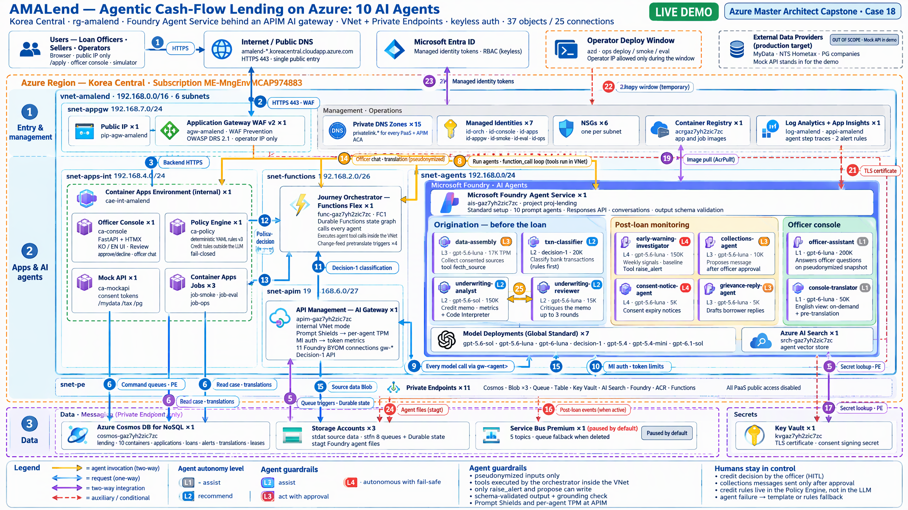

# Agentic Cash-Flow Lending

Case Study 18 캡스톤 데모다. 소상공인 운전자금 대출 심사를 2주에서 48시간으로 줄이는 것을 목표로 하는 에이전트 시스템을 Azure Korea Central에 실제로 구축했다. 합성 데이터로는 접수부터 심사역 대기열까지 p95 1.2분이 걸렸지만, 심사역 검토 시간과 실제 기관 API 지연이 빠져 있어 사업 목표 달성을 뜻하지 않는다([비즈니스 케이스](docs/business-case.md)). 에이전트는 데이터를 모으고 근거 있는 추천을 만들 뿐이고, 자격·한도·금리는 결정론적 정책 엔진이, 최종 결정은 심사역이 내린다. 실제 마이데이터·홈택스·PG 대신 Mock API와 합성 데이터를 쓴다.

**심사 의견 데모(2026-11-19):** 새 신청의 의견서는 마켓 판매 성과와 계좌 현금흐름을 대조하고, 심사역이 다음에 확인할 자료를 제시한다. [합성 평가 보고서](eval/reports/job-eval-x9w9ghx/report.md)에서 운영 모델 조합은 11건 모두 최종 근거 검사와 독립 검토를 통과했다. 실제 고객에 대한 정확도나 변경 전 대비 개선 폭을 측정한 결과는 아니다.

## 아키텍처 한눈에

[](docs/diagrams/architecture-v3-en-agents/02-amalend-agents-en.png)

자세히: [아키텍처](docs/architecture.md) · [에이전트](docs/agents.md) · [ADR 색인](docs/adr/README.md)

## 빠른 시작

로컬 테스트(Python 3.12, Windows PowerShell):

```powershell
py -3.12 -m venv .venv
.\.venv\Scripts\python -m pip install -e ".[dev]"
.\.venv\Scripts\python -m pytest
```

Azure 배포 요약(자세한 순서와 문제 대응은 [setup](docs/runbook/setup.md), [deploy](docs/runbook/deploy.md)):

```powershell
azd env new amalend --location koreacentral --subscription <구독 ID>
azd provision --no-prompt                 # 최초 프로비저닝
python -m ops window open --acr           # 배포 창: 운영자 IP만 잠시 허용 + 최초에는 인증서·게이트웨이 생성
python -m ops smoke                       # Private Endpoint 경로 + 콘솔 관문 검증(게이트웨이가 있어야 함)
python -m ops deploy all                  # 이미지 4종 + Functions 코드
python -m ops window close                # 작업 뒤 반드시 닫기
azd env get-value APPGW_FQDN              # 콘솔 주소: https://<APPGW_FQDN>/ (자체 서명 인증서 경고는 넘긴다)
```

콘솔은 Application Gateway WAF v2 뒤에 있다. 첫 `window open`은 인증서·게이트웨이를 만들려고 두 번 프로비저닝하므로 smoke는 그 뒤에 실행한다([ADR-011](docs/adr/ADR-011-appgw-waf-entry.md), [setup](docs/runbook/setup.md)). 게이트웨이 서브넷은 `Microsoft.Network/applicationGateways`로 위임하고 NSG `nsg-appgw`(인터넷 80/443 허용)를 둔다. IP 제한은 WAF 규칙이 맡는다. 모바일 회선 등으로 공인 IP가 바뀌어 콘솔이 403이면 `CONSOLE_IP`를 갱신한다([deploy](docs/runbook/deploy.md#콘솔-waf-운영자-ip-규칙)).

콘솔 화면은 한국어·영어를 지원한다. 두 콘솔 모두 사이드바 하단의 `한국어 · English` 링크나 `?lang=en`으로 바꾸고 선택은 `lang` 쿠키에 1년 남는다. 쿠키가 없으면 브라우저 `Accept-Language`를 따른다. 영문 화면에서 셀러 상호·정책 사유는 카탈로그로, 에이전트 의견·차주 문구는 기계 번역(`console-translator`, 점선 밑줄, 원문이 기준)으로 보인다. 번역 규칙·용어집은 [src/console/locales/README.md](src/console/locales/README.md)에 있다.

## 문서 지도

| 문서 | 내용 |
|---|---|
| [비즈니스 케이스](docs/business-case.md) | 이해관계자·사업 목표와 데모 측정값 대조, 단위 경제, 미추진 비용, 파일럿 지표 |
| [아키텍처](docs/architecture.md) | 컨테이너·네트워크·신청 흐름·사후 흐름·계약·장애 도메인·확장 경로 |
| [에이전트](docs/agents.md) | 에이전트별 역할·도구·가드레일과 공통 런타임 |
| [ADR 색인](docs/adr/README.md) | 아키텍처 결정 기록 ADR-001~011(오케스트레이션·모델 배포·결정론 정책·네트워크·인증·AI 게이트웨이·App Gateway WAF 진입 등) |
| [위협 모델](docs/security/threat-model.md) | STRIDE + AI 위험, 통제와 잔여 위험 |
| [비용 모델](docs/cost-model.md) | 건당 AI 비용·월 고정비·월 물량별 건당 총비용 |
| [한계와 운영 전환](docs/limitations.md) | as-built 한계, 상위 Spec 위험 현황, 운영 전환 체크리스트 |
| [증거 색인](docs/evidence.md) | 평가 루브릭 기준별 주장과 증거, 실측 보고서 목록 |
| [사고 리더십 초안](docs/thought-leadership.md) | 구축·측정에서 얻은 7가지 설계 원칙과 체크리스트(발행 전 초안, 영역 D) |
| [환경 준비](docs/runbook/setup.md) | 로컬 개발, Azure 준비, 최초 배포, 데모 모드 |
| [배포](docs/runbook/deploy.md) | 배포 창, 구성요소별 배포, 운영자 IP 변경 대응 |
| [운영](docs/runbook/operate.md) | 일시 정지·재개, smoke, 평가, 운영 지표·장애 주입, 비용 관리 |
| [문제 해결](docs/runbook/troubleshooting.md) | 증상별 원인과 대응 |
| [운영 실행 기록](docs/runbook/deploy-history.md) | P2~App Gateway WAF 배포·실측 원문 기록(이전 README 본문 보존) |

## 알려진 한계(요약)

- 실데이터·실사용자 대신 모의 API와 합성 데이터로 전 구간을 돌린 데모다(마이데이터·홈택스·PG는 Mock API).
- 콘솔 인증은 데모 모드(Easy Auth 꺼짐, WAF 운영자 IP 규칙만)이고 심사역 ID가 고정 값이라 감사 추적에 실제 신원이 없다([ADR-007](docs/adr/ADR-007-demo-auth-mode.md)).
- 측정 표본이 작아(SLO 24건, 평가 케이스 소수) 수치는 경향으로만 읽고, 공정성 경보 하나는 표본 잡음일 수 있다.
- 동의·삭제·이의제기 수명주기는 구현했으나 갱신·재조정·회신은 기록·시뮬레이션에 그치고, 데모 시나리오에 동의 철회 장면은 없다.
- 콘솔 진입은 자체 서명 인증서의 App Gateway WAF라 브라우저 경고가 뜬다. 운영 전환 과제(Entra 복원·공인 인증서·분산 서킷·다중 리전·모델 처리 위치)는 [한계와 운영 전환](docs/limitations.md)의 체크리스트에 모았다.

## 단계별 이력

각 단계의 배포·실측 원문은 [운영 실행 기록](docs/runbook/deploy-history.md)에 있다. 설계는 상위 [Spec](docs/superpowers/specs/2026-10-31-agentic-cashflow-lending-design.md)을 따른다.

| 단계 | 내용 | 계획 |
|---|---|---|
| P1 | 도메인 코어(계약·정책 엔진·Mock API) | [Plan](docs/superpowers/plans/2026-10-31-p1-domain-core.md) |
| P2 | Azure 인프라(VNet·Private Endpoint·Foundry) | [Plan](docs/superpowers/plans/2026-10-31-p2-azure-infra.md) |
| P3 | 신청 여정(Durable 오케스트레이터) | [Plan](docs/superpowers/plans/2026-10-31-p3-application-journey.md) |
| P4a | 심사 에이전트 | [Plan](docs/superpowers/plans/2026-10-31-p4a-underwriting-agents.md) |
| P4b | 심사역 콘솔 | [Plan](docs/superpowers/plans/2026-11-01-p4b-officer-console.md) |
| P5a | 조기경보·추심 | [Plan](docs/superpowers/plans/2026-11-01-p5a-early-warning-collections.md) |
| P5b | 동의 수명주기·이의제기 | [Plan](docs/superpowers/plans/2026-11-01-p5b-consent-lifecycle-grievance.md) |
| P6a | 평가 하네스 | [Spec](docs/superpowers/specs/2026-11-01-p6a-eval-harness-design.md) · [Plan](docs/superpowers/plans/2026-11-01-p6a-eval-harness.md) |
| P6b | 운영 지표·SLO·비용·장애 주입 | [Spec](docs/superpowers/specs/2026-11-02-p6b-ops-metrics-design.md) · [Plan](docs/superpowers/plans/2026-11-02-p6b-ops-metrics.md) |
| P6c | 문서·데모(리허설 2026-11-03 실시) | [Spec](docs/superpowers/specs/2026-11-02-p6c-docs-demo-design.md) · [Plan](docs/superpowers/plans/2026-11-02-p6c-docs-demo.md) |
| P7 | 심사 콘솔 UI 고도화 | [Spec](docs/superpowers/specs/2026-11-03-p7-console-ui-design.md) · [Plan](docs/superpowers/plans/2026-11-03-p7-console-ui.md) |
| P8 | 소액 대출·온라인 셀러 데이터 | [Spec](docs/superpowers/specs/2026-11-03-p8-small-loan-sellers-design.md) · [Plan](docs/superpowers/plans/2026-11-03-p8-small-loan-sellers.md) |
| P9 | 고객 신청 채널·재생 정지/재개·심사 화면 개선 | [Spec](docs/superpowers/specs/2026-11-04-p9-customer-intake-and-officer-ux-design.md) · [Plan](docs/superpowers/plans/2026-11-04-p9-customer-intake-and-officer-ux.md) |
| AI 게이트웨이 | 모든 LLM 호출을 APIM으로(에이전트별 TPM·Prompt Shields·토큰 지표) | [Spec](docs/superpowers/specs/2026-11-05-ai-gateway-apim-design.md) · [Plan](docs/superpowers/plans/2026-11-05-ai-gateway-apim.md) |
| 결정 반영 단축 | 심사역 결정 반영 약 11초 → 2.6초(큐 폴링 2초·always ready) | [기록](docs/runbook/deploy-history.md#2026-11-05-심사역-결정-반영-지연-단축) |
| App Gateway WAF | 콘솔 단일 진입점 App Gateway WAF v2(DRS 2.1, 운영자 IP), `cae-web` 제거 | [Spec](docs/superpowers/specs/2026-11-06-appgw-waf-design.md) · [Plan](docs/superpowers/plans/2026-11-06-appgw-waf.md) |
