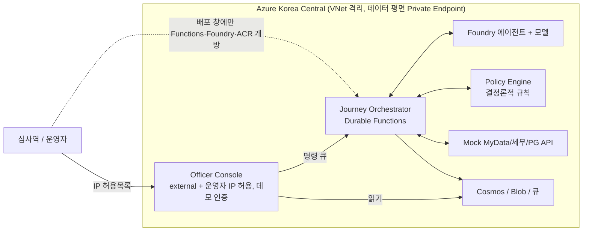

# Agentic Cash-Flow Lending

Case Study 18 캡스톤 데모다. 소상공인 운전자금 대출 심사를 2주에서 몇 분으로 줄이는 에이전트 시스템을 Azure Korea Central에 실제로 구축했다. 에이전트는 데이터를 모으고 근거 있는 추천을 만들 뿐이고, 자격·한도·금리는 결정론적 정책 엔진이, 최종 결정은 심사역이 내린다. 실제 마이데이터·홈택스·PG 대신 Mock API와 합성 데이터를 쓴다.

## 아키텍처 한눈에



자세히: [아키텍처](docs/architecture.md) · [에이전트](docs/agents.md) · [ADR 색인](docs/adr/README.md)

## 실측 결과(합성 데이터 기준)

모든 수치는 합성 데이터로 측정한 것이며 실제 고객·실제 성능이 아니다. 신청 24건 표본이라 경향으로만 읽는다([한계](docs/limitations.md)).

| 지표 | 값 | 출처 |
|---|---|---|
| SLO1: 접수 → 심사역 대기열 p95 | 1.2분(목표 ≤ 10분, n=24) | [load 보고서](ops/reports/load-20261102110233/report.md) 1장 |
| SLO2: 에이전트 단계 성공률 | 100.0%(72/72, 목표 ≥ 99.0%) | [load 보고서](ops/reports/load-20261102110233/report.md) 1장 |
| 건당 AI 비용 | $0.0423(캐시 할인 미반영 상한) | [load 보고서](ops/reports/load-20261102110233/report.md) 2장, [비용 모델](docs/cost-model.md) |
| 월 고정비 | $304.73(Cost Management 하루치 × 30) | [load 보고서](ops/reports/load-20261102110233/report.md) 2장, [비용 모델](docs/cost-model.md) |
| 건당 총비용(월 1,000건) | $0.35(정밀값 $0.3470) | [비용 모델](docs/cost-model.md), [load 보고서](ops/reports/load-20261102110233/report.md) 2장 |
| 거래 분류: 규칙 선분류 비율 | 80.0%(전체 4,128건) | [P6a 평가](eval/reports/job-eval-9imbutm/report.md) 2장 |
| 거래 분류: 범용 LLM 폴백 비율 | decision-1+mini 25.0% (mini 단독 100.0%), 두 구성 모두 macro F1 1.000 | [P6a 평가](eval/reports/job-eval-9imbutm/report.md) 2장 |
| 장애 2종 회복 | source-flaky: 신청 전부 `awaiting_officer` 복귀. policy-down: fail-closed로 `policy:failed`에서 멈추고 `awaiting_officer`로 넘김(판정 없이 진행 안 함) | [load 보고서](ops/reports/load-20261102110233/report.md) 4장 |

증거와 보고서 전체 색인은 [증거 색인](docs/evidence.md)에 있다.

## 빠른 시작

로컬 테스트(Python 3.12, Windows PowerShell):

```powershell
py -3.12 -m venv .venv
.\.venv\Scripts\python -m pip install -e ".[dev]"
.\.venv\Scripts\python -m pytest
```

Azure 배포 요약(자세한 순서와 문제 대응은 [setup](docs/runbook/setup.md), [deploy](docs/runbook/deploy.md)):

```powershell
azd env new amalend --location koreacentral --subscription <구독 ID>
azd provision --no-prompt                 # 최초 프로비저닝
python -m ops smoke                       # VNet 안에서 Private Endpoint 경로 검증
python -m ops window open --acr           # 배포 창: 운영자 IP만 잠시 허용
python -m ops deploy all                  # 이미지 4종 + Functions 코드
python -m ops window close                # 작업 뒤 반드시 닫기
```

## 문서 지도

| 문서 | 내용 |
|---|---|
| [아키텍처](docs/architecture.md) | 컨테이너·네트워크·신청 흐름·사후 흐름·계약·장애 도메인·확장 경로 |
| [에이전트](docs/agents.md) | 에이전트별 역할·도구·가드레일과 공통 런타임 |
| [ADR 색인](docs/adr/README.md) | 아키텍처 결정 기록 ADR-001~009(오케스트레이션·모델 배포·결정론 정책·네트워크·인증 등) |
| [위협 모델](docs/security/threat-model.md) | STRIDE + AI 위험, 통제와 잔여 위험 |
| [비용 모델](docs/cost-model.md) | 건당 AI 비용·월 고정비·월 물량별 건당 총비용 |
| [한계와 운영 전환](docs/limitations.md) | as-built 한계, 상위 Spec 위험 현황, 운영 전환 체크리스트 |
| [증거 색인](docs/evidence.md) | 평가 루브릭 기준별 주장과 증거, 실측 보고서 목록 |
| [데모 대본](docs/demo/demo-script.md) | 2분 데모 장면 구성 |
| [데모 대비책](docs/demo/fallback.md) | 장애 시 대체 경로와 사전 건 |
| [데모 리허설](docs/demo/rehearsal.md) | 리허설 절차와 기록표(리허설 전이라 기록은 비어 있음) |
| [환경 준비](docs/runbook/setup.md) | 로컬 개발, Azure 준비, 최초 배포, 데모 모드 |
| [배포](docs/runbook/deploy.md) | 배포 창, 구성요소별 배포, 운영자 IP 변경 대응 |
| [운영](docs/runbook/operate.md) | 일시 정지·재개, smoke, 평가, 운영 지표·장애 주입, 비용 관리 |
| [문제 해결](docs/runbook/troubleshooting.md) | 증상별 원인과 대응 |
| [운영 실행 기록](docs/runbook/deploy-history.md) | P2~P6b 배포·실측 원문 기록(이전 README 본문 보존) |

## 알려진 한계(요약)

- 실데이터·실사용자 대신 모의 API와 합성 데이터로 전 구간을 돌린 데모다(마이데이터·홈택스·PG는 Mock API).
- 콘솔 인증은 데모 모드(Easy Auth 꺼짐, 운영자 IP 허용목록만)이고 심사역 ID가 고정 값이라 감사 추적에 실제 신원이 없다([ADR-007](docs/adr/ADR-007-demo-auth-mode.md)).
- 측정 표본이 작아(SLO 24건, 평가 케이스 소수) 수치는 경향으로만 읽고, 공정성 경보 하나는 표본 잡음일 수 있다.
- 동의·삭제·이의제기 수명주기는 구현했으나 갱신·재조정·회신은 기록·시뮬레이션에 그치고, 데모 시나리오에 동의 철회 장면은 없다.
- 운영 전환 과제(Entra 복원·App Gateway WAF·분산 서킷·다중 리전·모델 처리 위치)는 [한계와 운영 전환](docs/limitations.md)의 체크리스트에 모았다.

## 단계별 이력

각 단계의 배포·실측 원문은 [운영 실행 기록](docs/runbook/deploy-history.md)에 있다. 설계는 상위 [Spec](docs/superpowers/specs/2026-10-31-agentic-cashflow-lending-design.md)을 따른다.

| 단계 | 내용 | 계획 |
|---|---|---|
| P1 | 도메인 코어(계약·정책 엔진·Mock API) | [Plan](docs/superpowers/plans/2026-10-31-p1-domain-core.md) |
| P2 | Azure 인프라(VNet·Private Endpoint·Foundry) | [Plan](docs/superpowers/plans/2026-10-31-p2-azure-infra.md) |
| P3 | 신청 여정(Durable 오케스트레이터) | [Plan](docs/superpowers/plans/2026-10-31-p3-application-journey.md) |
| P4a | 심사 에이전트 | [Plan](docs/superpowers/plans/2026-10-31-p4a-underwriting-agents.md) |
| P4b | 심사역 콘솔 | [Plan](docs/superpowers/plans/2026-11-01-p4b-officer-console.md) |
| P5a | 조기경보·추심 | [Plan](docs/superpowers/plans/2026-11-01-p5a-early-warning-collections.md) |
| P5b | 동의 수명주기·이의제기 | [Plan](docs/superpowers/plans/2026-11-01-p5b-consent-lifecycle-grievance.md) |
| P6a | 평가 하네스 | [Spec](docs/superpowers/specs/2026-11-01-p6a-eval-harness-design.md) · [Plan](docs/superpowers/plans/2026-11-01-p6a-eval-harness.md) |
| P6b | 운영 지표·SLO·비용·장애 주입 | [Spec](docs/superpowers/specs/2026-11-02-p6b-ops-metrics-design.md) · [Plan](docs/superpowers/plans/2026-11-02-p6b-ops-metrics.md) |
| P6c | 문서·데모(진행 중, 실제 환경 리허설 전) | [Spec](docs/superpowers/specs/2026-11-02-p6c-docs-demo-design.md) · [Plan](docs/superpowers/plans/2026-11-02-p6c-docs-demo.md) |
