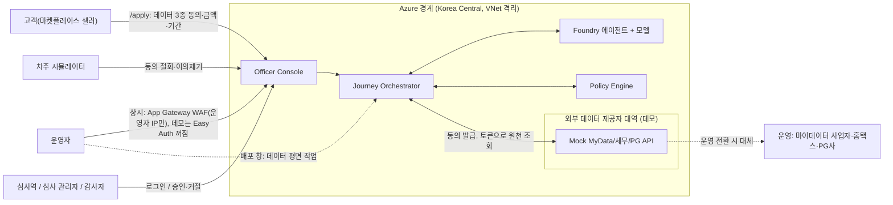
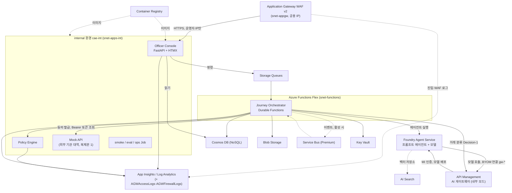
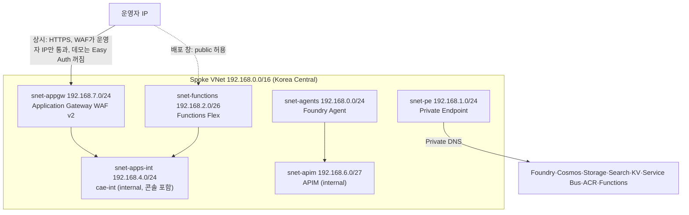
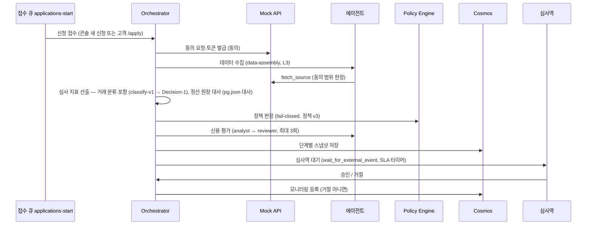
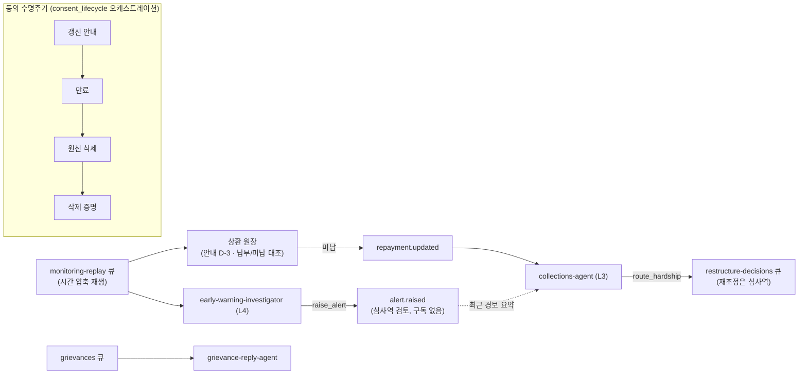

# 아키텍처

동의 기반 합성 데이터로 SME 현금흐름 대출을 심사·모니터링·추심하는 에이전트 시스템의 as-built 아키텍처다. 신청 건별 흐름은 Durable Functions 오케스트레이터가 결정론적 상태 그래프로 관리하고, 각 단계 안에서 Foundry 프롬프트 에이전트가 도구를 써서 자율 판단한다. 신용 규칙은 LLM 밖의 결정론적 Policy Engine이 판정하고, 최종 결정은 심사역이 콘솔에서 내린다. 데이터·제어 평면은 VNet 격리 + Private Endpoint로 닫혀 있고 무키(managed identity) 인증을 쓰며, 외부로 열린 진입점은 Application Gateway WAF v2 앞단의 콘솔뿐이고 WAF가 운영자 IP가 아닌 요청을 막는다([ADR-011](adr/ADR-011-appgw-waf-entry.md); 데모 모드는 Easy Auth 꺼짐, [ADR-007](adr/ADR-007-demo-auth-mode.md) 참조; 운영 전환 시 Entra 복원).

> **합성 데이터 기준.** 실제 마이데이터·홈택스·PG API 대신 합성 데이터와 Mock API를 쓴다. 실측 수치는 `ops/reports/load-20261102110233/report.md`, `eval/reports/job-eval-9imbutm/report.md`에서 인용하며, 배포·운영 실행 기록은 [runbook/deploy-history.md](runbook/deploy-history.md)에 있다.

> 상위 Spec 대비: 설계 Spec(`docs/superpowers/specs/2026-10-31-agentic-cashflow-lending-design.md`)은 에이전트를 5종으로 묶었으나, 구현은 역할을 8개 `AgentSpec`으로 분리했다(아래 [에이전트](agents.md) 참고). 코드가 기준이다.

## 시스템 컨텍스트

고객(마켓플레이스 셀러)은 콘솔의 고객 신청 페이지(`/apply`)에서 은행·세무·PG 데이터 3종에 모두 동의하고 금액(50만~1,000만 원)·기간(3~6개월, 기본 6개월)을 넣어 신청한다(`src/console/customer.py`). 이 신청은 심사역 콘솔과 같은 접수 큐로 들어가 같은 흐름을 탄다. 심사역·운영자는 콘솔로 들어온다. 콘솔 앱은 internal 환경 `cae-int`에 있고, 인터넷에서는 공용 IP → Application Gateway WAF v2(`snet-appgw`)를 거쳐서만 닿는다. WAF 사용자 지정 규칙이 운영자 공인 IP(`CONSOLE_IP`)가 아닌 요청을 403으로 막는다([ADR-011](adr/ADR-011-appgw-waf-entry.md); 데모 모드는 Easy Auth 꺼짐, [ADR-007](adr/ADR-007-demo-auth-mode.md) 참조; 운영 전환 시 Entra 복원). 운영자 데이터 평면 작업(Functions·Foundry·ACR 빌드)만 배포 창에서 잠시 열린다(아래 [네트워크](#네트워크)). 결정 탭의 심사 도우미 채팅은 콘솔이 가명 스냅샷을 만들어 콘솔 관리 ID로 Foundry 에이전트 `officer-assistant`를 부르고, 모델 호출은 APIM 연결 `gw-officer-chat`(gpt-6-luna)을 거친다([에이전트](agents.md#심사역-결정-채팅)).

## 컨테이너

| 구성요소 | 호스팅 | 책임 | 데이터 | 인증 | 코드 경로 |
|---|---|---|---|---|---|
| Officer Console | Container Apps internal `cae-int`(진입은 Application Gateway WAF v2) | 고객 신청 페이지(`/apply`), 신청 목록·탭형 상세 근거 열람, 승인/거절, 사후 재생(재조정 대기 시 정지·재개)·4주 잔고 전망, 공정성·이의제기 화면 | Cosmos(읽기), 큐(명령 전송) | Easy Auth(Entra, 리디렉션 URI는 게이트웨이 이름). 운영자 IP 제한은 WAF 규칙. `consoleAuthEnabled=false`면 데모 고정 역할 | `src/console/app.py`, `src/console/auth.py` |
| Application Gateway WAF v2 | `snet-appgw`, 공용 IP `pip-agw-*`(DNS 레이블), WAF_v2 자동 확장 0–2 | HTTPS 종단(Key Vault 자체 서명 인증서), HTTP→HTTPS 영구 리디렉션, WAF 정책(Prevention, OWASP DRS 2.1, `allowOperatorOnly`), 백엔드 HTTPS·`/healthz` 프로브 | 없음 | 사용자 할당 ID `id-appgw-*`(Key Vault Secrets User) | `infra/modules/appgw.bicep`, `src/ops/appgw_cert.py` |
| Journey Orchestrator | Azure Functions Flex Consumption `FC1`(`snet-functions`) | 신청 건별 상태 그래프, HITL 대기, 재시도·보상, 단계 계약 검증, 계량 | Cosmos, Blob, 큐, (활성 시) Service Bus | Managed Identity(`id-orch`) | `src/orchestrator/function_app.py`, `src/orchestrator/journey/` |
| Policy Engine | Container Apps internal `cae-int` | 버전드 YAML 규칙으로 자격·한도·금리 구간 판정, reason code 반환(순수 함수) | 없음 | Managed Identity(`id-apps`), 환경 내부 ingress(`internal: true`) | `src/policy/app.py`, `src/policy/engine.py`, `src/policy/rules.py` |
| Mock API | Container Apps internal `cae-int`(복제본 1) | 외부 데이터 제공자 대역. 동의 발급·철회(HMAC 서명 토큰), 셀러 합성 원천 데이터(채널별 정산 주기·수수료·매입·급여·세금 일정, 정산 원장과 계좌 입금을 따로 만들어 시점 차이·광고비 상계·선정산 양도를 반영) 제공, 범위·만료 동의 토큰 검증, 대출 후 흐름 재생, 장애 주입(`FAULT_MODE`) | 합성 데이터(시드로 프로세스 내 결정적 생성), 동의 레지스트리(메모리) | Managed Identity(`id-apps`), 환경 내부 ingress, `MOCK_CONSENT_SECRET` | `src/mockapis/app.py`, `src/mockapis/consent.py`, `src/mockapis/postloan.py` |
| 에이전트(8종) | Foundry Agent Service(standard setup, capability host) | 단계 안 자율 판단. 사내 도구는 오케스트레이터가 실행(function tool) | 도구 경유 | Managed Identity(`id-orch`) → `Azure AI User`/`Cognitive Services OpenAI User` | `src/agents/` |
| AI 게이트웨이 | API Management Developer, 내부 VNet 모드(`snet-apim`) | 에이전트별 TPM 한도, 콘텐츠 안전(Prompt Shields), 토큰 지표(agent·model) | 없음(본문 미기록) | 에이전트별 구독 키(Foundry 연결) → APIM MI로 Foundry 호출 | `infra/modules/apim.bicep`, `infra/modules/foundry/gateway-connections.bicep`, `src/agents/gateway.py` |
| AI Search | Azure AI Search Basic + PE | Foundry 벡터 저장소 연결(지식 인덱스) | 인덱스 | System-assigned MI, `publicNetworkAccess: disabled` | `infra/modules/search.bicep` |
| Container Registry | Azure Container Registry + PE | 콘솔·Policy·Mock·Job 컨테이너 이미지 | 이미지 | MI `AcrPull`, 배포 창에 운영자 push | `infra/modules/acr.bicep` |
| smoke/eval/ops Job | Container Apps Job internal `cae-int` | 배포 후 스모크, 분류·심사 평가, 운영 리포트 생성 | id-eval: Blob `eval-reports`(쓰기)·Foundry/OpenAI; id-ops: Cosmos(읽기)·큐; id-smoke: Cosmos·Blob(읽기)·큐·Service Bus(송신)·Key Vault·Foundry(전 경로 점검) | Managed Identity(`id-smoke`/`id-eval`/`id-ops`) | `infra/modules/smoke-job.bicep`, `infra/modules/eval-job.bicep` |
| Service Bus | Service Bus Premium + PE | `consent`·`flow.updated`·`alert.raised`·`repayment.updated`·`grievance` 토픽. 평상시 pause(삭제) | 없음 | Managed Identity | `infra/modules/servicebus.bicep`, `src/ops/lifecycle.py` |
| 데이터 저장소 | Cosmos DB(NoSQL), Blob Storage | 신청·동의·분류·대출·경보·삭제 증명·이의, 원천 데이터·리포트 | — | Cosmos SQL RBAC, Storage Entra RBAC | `infra/modules/cosmos.bicep`, `infra/modules/storage.bicep` |
| 플랫폼 | Key Vault, Managed Identity, App Insights, Log Analytics | 비밀·무키 인증·관측성 | — | RBAC | `infra/modules/keyvault.bicep`, `infra/modules/identities.bicep`, `infra/modules/monitoring.bicep` |

**경계 원칙:** 구성요소 사이에는 `src/shared/contracts.py`의 버전드 Pydantic 계약만 오간다. 에이전트는 서로 직접 호출하지 않고, handoff는 오케스트레이터나 이벤트로만 일어난다. 사내 도구(Mock API·Policy·데이터 조회)는 Foundry가 아니라 VNet 안 오케스트레이터가 실행해 감사 로그에 남긴다.

### 외부 데이터 제공자 경계 (Mock API)

Mock API는 우리 시스템 구성요소가 아니라 **외부 기관의 대역**이다. 데모라서 VNet 안 Container App으로 띄웠지만, 오케스트레이터는 외부 API를 부르듯 동의를 받고 그 토큰으로만 원천을 조회한다(`src/orchestrator/journey/adapters.py`의 `HttpMockApi`). 그래서 운영 전환 때는 이 어댑터와 연결 대상만 바뀌고 여정·에이전트·계약은 그대로다.

| 엔드포인트 | 대역 대상 | 운영 전환 시 |
|---|---|---|
| `POST /consents`, `POST /consents/{id}/revoke` | 제공기관의 동의·토큰 발급과 철회 | 제공기관 표준 인증·동의 절차와 토큰 수명 관리 |
| `/mydata/profile`, `/mydata/transactions`, `/mydata/flow` | 마이데이터 사업자(은행 계좌 프로필·거래, 대출 후 거래) | 마이데이터 표준 API |
| `/tax/filings` | 홈택스(세금 신고) | 세무 데이터 제공 경로 |
| `/pg/settlements` | PG사(카드·간편결제 정산) | PG사 정산 API |
| `/admin/faults`, `FAULT_MODE` | 제공기관 장애(503 전부·원천별 첫 요청) | 없음(시연·장애 시나리오 전용) |

동의 원장은 둘이다. **우리 쪽 원장**은 Cosmos `consents`(범위·만료·철회 상태)와 `deletion_proofs`(삭제 증명)로, 콘솔과 수명주기 오케스트레이션이 이것을 기준으로 삼는다. **제공기관 쪽 원장**은 Mock API의 메모리 레지스트리로, 외부 기관 내부를 흉내 낸 것이라 영속화하지 않았다. 토큰은 HMAC 서명과 만료를 스스로 담아 재시작 뒤에도 유효하지만 철회 목록은 사라진다. 그래서 복제본을 1개로 고정하고, 재시작 뒤 철회는 `absent`로 기록한다([ADR-009](adr/ADR-009-deletion-vs-explainability.md), [한계](limitations.md)).
> 상위 Spec 대비: Spec §2.3은 Service Bus Premium을 상시 가정하지만, 비용 때문에 평상시 pause(네임스페이스 삭제)한다. 이때 `SERVICEBUS_FQDN`이 비어 트리거를 등록하지 않고, `src/orchestrator/journey/monitoring.py`의 `handle_replay`가 `monitoring-replay` 큐로 같은 처리를 인라인 수행한다.

## 네트워크

평상시 모든 PaaS 리소스의 public network access는 꺼져 있고 Private Endpoint로만 접근한다. 운영자 데이터 평면 작업(배포·시드)에는 `operatorIp` 파라미터로 Functions·Foundry·ACR(빌드)의 public access를 잠시 켜고 기본 거부 + 운영자 IP 허용을 적용한 뒤 작업이 끝나면 다시 끈다(`infra/modules/functions.bicep`: `publicNetworkAccess`는 `operatorIp`가 있을 때만 `Enabled`). 콘솔은 internal 환경 `cae-int`에 있어 VNet 밖에서 직접 닿지 않는다. 인터넷 진입은 공용 IP의 Application Gateway WAF v2 하나뿐이고(상시, 배포 창 토글과 무관), WAF 사용자 지정 규칙 `allowOperatorOnly`가 `CONSOLE_IP`(`window open`이 설정) 밖의 요청을 막는다. 비어 있으면 `192.0.2.0/32`만 허용해 fail-closed다. 게이트웨이는 Key Vault의 자체 서명 인증서(비밀 `appgw-console`)를 사용자 할당 ID로 읽고, 백엔드는 콘솔 FQDN으로 HTTPS 연결한다([ADR-011](adr/ADR-011-appgw-waf-entry.md); 데모 모드는 Easy Auth 꺼짐, [ADR-007](adr/ADR-007-demo-auth-mode.md) 참조; 운영 전환 시 Entra 복원). 진입·WAF 로그(`AGWAccessLogs`, `AGWFirewallLogs`)는 Log Analytics로 간다.

| 서브넷 | 주소 | 위임 | 용도 |
|---|---|---|---|
| `snet-agents` | `192.168.0.0/24` | 예 | Foundry Agent Service 전용 |
| `snet-pe` | `192.168.1.0/24` | 아니오 | Private Endpoint |
| `snet-functions` | `192.168.2.0/26` | 예 | Functions Flex Consumption VNet 통합 |
| `snet-apps-int` | `192.168.4.0/24` | 예 | internal Container Apps 환경(콘솔·Policy·Mock·Job) |
| `snet-appgw` | `192.168.7.0/24` | 예 | Application Gateway WAF v2(`Microsoft.Network/applicationGateways` 위임(네트워크 격리 필수), `nsg-appgw`(GatewayManager·AzureLoadBalancer·Internet 80/443 허용; IP 제한은 WAF 사용자 지정 규칙)) |
| `snet-apim` | `192.168.6.0/27` | 아니오 | APIM 내부 모드(게이트웨이 사설 IP, 공인 IP 없음) |

주소·프리픽스는 `infra/modules/network.bicep`의 템플릿 값이다. 서브넷마다 Bicep이 소유한 NSG가 붙는다: `snet-appgw`는 `nsg-appgw`, `snet-apim`은 `nsg-apim`(APIM 관리·LB·VNet 443과 Storage·SQL·Key Vault·Monitor 아웃바운드), 나머지 네 서브넷은 `nsg-agents`·`nsg-pe`·`nsg-functions`·`nsg-apps-int`(사용자 규칙 없이 Azure 기본 규칙만: VNet·AzureLoadBalancer 인바운드 허용, 인터넷 인바운드 거부). 테넌트 정책이 NSG 없는 서브넷에 빈 NSG를 붙이지만 Bicep이 소유하지 않으면 프로비저닝마다 연결이 풀려 "NSG 없는 서브넷" 경고가 뜨므로 직접 둔다(2026-11-10). Private Endpoint·DNS zone은 `infra/modules/pe.bicep`와 `infra/modules/dns.bicep`로 리소스별(`infra/resources.bicep` 호출부)에 붙는다: Key Vault, Storage(blob/queue/table), Cosmos, AI Search, Foundry 계정, Service Bus, ACR, Functions.

## AI 게이트웨이

모든 운영 LLM 호출은 APIM(Developer, 내부 VNet 모드)을 지난다([ADR-010](adr/ADR-010-ai-gateway.md)). `AI_GATEWAY_ROUTING=true`(Bicep)면 에이전트마다 Foundry BYOM 연결 `gw-*`가 있고, Agent Service는 `POST /openai/deployments/<모델>/chat/completions`로 APIM을 부른다. 정책은 콘텐츠 안전(Prompt Shields) → 에이전트별 `llm-token-limit`(TPM) → 관리 ID 인증 → 토큰 지표 순이다. 프롬프트가 1만 자를 넘으면 Prompt Shields가 거부하므로 그때는 카테고리 검사만 돌고 모델 배포의 `Microsoft.DefaultV2` 필터가 남는다. 거래 분류 Decision-1은 `AI_GATEWAY_URL`의 decision API(콘텐츠 안전 없음)로 가고, 평가 채점자(quality-judge)는 직접 호출한다. 429는 `GatewayThrottled`, 403(Agent Service에는 HTTP 424 + `innerStatusCode 403`으로 전달)은 `GatewayBlocked`로 분류한다. 게이트웨이 경로는 도구 호출이 적어 라우팅된 에이전트에만 `GATEWAY_MAX_ROUNDS = 12`를 쓴다([에이전트](agents.md#공통-런타임)). 에이전트별 연결·TPM은 [에이전트](agents.md#공통-런타임)에 있다.

## 신청 1건 흐름

단계 이름은 `src/opsmetrics/labels.py`의 `STEP_LABELS`를 따른다: 동의(consent) → 데이터 수집(assemble) → 거래 분류(classify) → 심사 지표 산출(underwrite) → 정책 판정(policy) → 신용 평가(assess). 거래 분류는 심사 지표 산출 활동 안의 하위 단계다(`src/orchestrator/journey/metering.py`). 데이터가 불완전하면(`FLAG_DATA_INCOMPLETE`) 심사를 건너뛰고 바로 심사역 대기로 간다(`src/orchestrator/journey/orchestration.py`).

**정산 원장 데이터 흐름(2026-11-08, 새 지표·확인 사항 2026-11-10).** 데이터 수집이 원천 저장소(Blob)에 넣은 `pg.json`을 심사 지표 산출 활동이 선택으로 읽어(없거나 손상되면 빈 목록 + 손상이면 `pg_ledger_unavailable` 플래그) 계좌 거래와 대조한다(`src/agents/pg_ledger.py`의 `ledger_summary`, [에이전트](agents.md#정산-원장-대사)). 결과는 세 곳으로 간다. ① 정산 지표(`pg_reconciliation_ratio`·`pg_top_platform_share`)가 심사 특성에 들어가 정책 v3(R107·R108)이 판정한다. 값이 없으면 그 규칙은 적용하지 않는다. 나머지 지표(`pg_hhi`·`pg_take_rate_trend_pp`·`pg_offset_rate_trend_pp`·`pg_cash_conversion_days`·`pg_advance_suspected_count`·`pg_advance_share`, 선정산 추정 포함)는 정책에는 쓰이지 않고 심사 신호(signals)로만 남는다. ② 상세(플랫폼별 비중·월별 공제율·미매칭 정산 최근 10건과 짝지어진 선정산 추정)가 신청 문서의 `underwriting.pg_ledger`에 저장되어 신용 평가 단계의 분석가 도구 `get_settlement_summary`와 `M:pg_*` 근거 ID가 된다. `get_settlement_summary`가 LLM에 돌려주는 값은 기간·건수·지표 ID·플랫폼 비중·월별 공제율·미입금 건수뿐인 집계이며, 미입금 개별 금액과 선정산 짝의 날짜·금액은 넘기지 않는다(심사역 채팅 스냅샷도 같다). 분석가는 이 정산 근거(`M:pg_*` 또는 `P:R107`·`P:R108`)를 들어 심사역이 확인할 사항(`officer_checks`, 최대 3개)을 낼 수 있고, 검토자의 `check_verdicts` 판정을 거쳐 `CreditAssessment.officer_checks`에 담긴다. ③ 같은 집계 값과 확인 사항을 콘솔 상세의 "정산 대사" 카드와 "에이전트 확인 사항" 패널이 읽는다. 정책·에이전트·콘솔 모두 정산 값을 다시 계산하지 않는다.

## 사후 흐름

조기경보는 `flow.updated`(활성 시 Service Bus, 평상시 `monitoring-replay` 큐)로 재생되어 통계 탐지기 트리거 시 조사 에이전트가 돈다. 경보는 심사역 검토용이다. `alert.raised`는 발행하지만 현재 구독자가 없다. 같은 주차 처리에서 상환 원장이 상환일 3일 전 안내(LLM 없음)를 보내고, 상환일 당일 대출상환 출금이 없으면 미납 추심 건(`rc-`)을 만들어 `repayment.updated`로 Collections를 부른다(추심 에이전트는 최근 경보 요약을 참고만 한다). 주차는 한 주씩 발행되고(앞 주차와 추심이 끝난 뒤 다음 주차), Collections가 재조정 요청을 만들면 재생이 멈췄다가 심사역 결정 뒤 재개·종료를 고른다(`_after_week`, `src/orchestrator/journey/monitoring.py`). 매주 `agents.forecast`가 심사 시점 정산 프로필(채널별 정산 지연·수수료)과 최근 3개월 고정 지출 일정(임대료·급여·4대보험·원천세·부가세·대표자 인출·기존/이번 대출 원리금, 매출 비례 운영비)으로 다음 28일 잔고를 전망하고(`project`), 0원 아래로 내려가면 `projected_shortfall` 트리거를 건다. 경보 근거는 `F:<주차>:projected_min_balance`처럼 전망 지표를 인용할 수 있다. 동의마다 `consent_lifecycle` 오케스트레이션(인스턴스 `consent-<id>`)이 만료까지 기다렸다가 원천 데이터(Blob)·목업 레지스트리·Foundry 대화를 지우고 `deletion_proofs`에 삭제 증명을 남긴다(`src/orchestrator/journey/consent.py`). 이의제기는 `grievances` 큐로 접수되어 회신 초안을 만든다(`src/orchestrator/journey/grievance.py`).

## 구성요소 계약

모든 계약은 `src/shared/contracts.py`에 있고, `Contract` 기반(frozen, `extra="forbid"`)에 `schema_version="1"`을 붙인다.

| 계약 | 용도 |
|---|---|
| `ConsentGrant` v1 | 동의 토큰(범위·만료) |
| `ApplicantProfile` v1 | 사업자 프로필(업종·지역·업력) |
| `Transaction` v1 | 거래(유형 코드·적요·금액) |
| `TaxFiling` v1 | 세무 신고 |
| `PgSettlement` v1 | 카드·PG 정산(`deduction_krw` 광고비·물류비 상계 기본값 0, `net = gross − fee − deduction`) |
| `CashFlowFeatures` v1 | 심사 지표(DSCR·버퍼·변동성 등) |
| `PolicyDecision` v1 | 정책 판정(자격·한도·금리·`rules_version`·reason code) |
| `CreditAssessment` v1 | 평가(추천·근거 `Claim`·`ProposedStructure`·`Counterfactual`) |
| `EarlyWarningAlert` v1 | 경보(심각도·`AlertSignal`·권고 조치) |

`ReasonCode`, `Claim`, `ProposedStructure`, `Counterfactual`, `ReviewOutcome`, `AlertSignal`은 위 계약의 하위 모델이다.

## 장애 도메인

| 장애 도메인 | 영향 | 격리·대응(as-built) | 실측 증거 |
|---|---|---|---|
| Foundry 에이전트·모델 | 심사 단계 지연·실패 | 평가가 없으면 오케스트레이터가 한 번 더 시도하고(`ASSESS_ATTEMPTS=2`), 그래도 없으면 `assessment_unavailable` 플래그와 함께 `failed`(오류 단계 `assess_credit`)로 끝낸다. 심사역은 에이전트 평가를 근거로 결정하므로 평가 없는 건을 심사역 대기로 넘기지 않는다(2026-11-07 변경, 이전에는 플래그만 남기고 넘겼다). 데이터 부족·정책 장애는 평가를 만들 근거가 없어 기존대로 심사역에게 간다(fail-closed) | 에이전트 단계 성공률 100.0%(ok 72/72) `ops/reports/load-20261102110233/report.md` |
| Mock API | 데이터 수집 실패 | 동의 범위 안 재시도 + 안전망 수집. 불완전이면 "데이터 불완전"으로 심사역에게 넘김 | source-flaky 회복: mockapi 호출 일부 실패에도 전 신청 `awaiting_officer` 복귀(`ops/reports/fault-20261102111447/`) — `ops/reports/load-20261102110233/report.md` 4장 |
| Policy Engine | 판정 불가 | fail-closed: 판정 없이 진행 안 함. `policy_unavailable`+`assessment_unavailable` 플래그, 심사역 판단으로 넘김. 호출에 프로세스 단위 서킷(`src/orchestrator/journey/circuit.py`) | policy-down: 3건 모두 `policy:failed`로 멈추고 `awaiting_officer`(`ops/reports/fault-20261102111750/`) — `ops/reports/load-20261102110233/report.md` 4장 |
| Service Bus | L4 이벤트 지연 | 세션 구독(`requiresSession`)·중복 감지(멱등 지원)·만료 dead-letter. 평상시 pause 시 `monitoring-replay` 큐 인라인 처리 | 세션·중복 감지·`deadLetteringOnMessageExpiration` 설정 `infra/modules/servicebus.bicep` |
| AI 게이트웨이(APIM) | 모든 LLM 호출 실패·지연 | 429는 `GatewayThrottled`, 403은 `GatewayBlocked`로 구분해 사용량 `gateway`(`rate_limited`·`content_blocked`) 태그로 남긴다. 단계 결과는 단계 규칙을 따른다: 신용 평가는 평가가 비면 `failed`(부하 실측에서 `gw-analyst` 429로 1건), 안전망·폴백이 있는 단계는 폴백으로 이어진다. 콘솔 배지는 콘텐츠 차단(403)만 표시한다. 장애 시 `AI_GATEWAY_ROUTING=false`로 직접 호출 복귀 | 프로브 재현 `eval/reports/<실행>/probe.json`(Task 11): 콘텐츠 차단 `job-eval-aw9qy70`, 토큰 한도 `job-eval-5zu5jnw` |

**한계:** 서킷 브레이커는 프로세스(Flex 인스턴스) 단위다(`src/orchestrator/journey/circuit.py`). Flex가 여러 인스턴스로 확장되면 서킷 상태가 인스턴스별로 따로 쌓여 전역 open이 보장되지 않는다. 분산 서킷은 운영 전환 과제다([ADR-001](adr/ADR-001-orchestration.md) 재검토 조건).

## 확장 경로

| 축 | 현재 | 확장 |
|---|---|---|
| 처리량 | Functions Flex `maximumInstanceCount: 40`, Container Apps 수평 확장 | 인스턴스 상한 상향, 동시성 조정 |
| 데이터 | Cosmos DB 기본 RU | 컨테이너별 RU 상향·자동 확장 |
| 모델 | Global Standard, 배포 `gpt-5.4`/`gpt-5.6-luna`(소형 에이전트, 2026-11-08 `gpt-5.4-mini`에서 변경)/`gpt-5.6-sol`(분석가·평가)/`gpt-6.1-sol`(보유만)/`decision-1` | TPM 쿼터 상향 |
| 분류 비용 | 규칙(classify-v1) 선분류 + 정규화·중복 제거 + 캐시 + Decision-1, 폴백만 mini LLM | 규칙 커버리지 80.0%·캐시 적중 25.0%. `decision-1+mini` 구성은 범용 LLM 폴백 비율 25.0%(mini 단독 100.0%)로 범용 LLM 호출을 줄인다. `decision-1+mini` 구성의 분류 호출은 신청당 8.375회(Decision-1 7.5회 + mini 폴백)지만 Decision-1 단가 미확인이라 총비용 효과는 미검증(`eval/reports/job-eval-9imbutm/report.md` 2장) |
| 지연·단가 | Global Standard | PTU 전환(예측 가능 지연·단가, [ADR-002](adr/ADR-002-model-deployment.md)) |
| 가용성 | 단일 리전(Korea Central) | 다중 리전 DR(문서만) |

## 운영 아키텍처

이 절은 데모와 운영의 차이로 남은 운영 전환 과제다.

| 항목 | 데모 | 운영 전환 시 |
|---|---|---|
| 외부 진입 | Application Gateway WAF v2(Prevention, DRS 2.1, 운영자 IP만), 자체 서명 인증서([ADR-011](adr/ADR-011-appgw-waf-entry.md)). 데모: Easy Auth 꺼짐([ADR-007](adr/ADR-007-demo-auth-mode.md)) | 공인 CA 인증서·사용자 도메인, 운영자 IP 규칙 대신 Entra 단일 진입 |
| 심사역 인증 | Easy Auth implicit id_token, `consoleAuthEnabled=false` 시 데모 역할 | Entra 로그인 복원(비밀 또는 FIC 기반 인증 코드 흐름, [ADR-007](adr/ADR-007-demo-auth-mode.md)) |
| 서킷 브레이커 | 프로세스(Flex 인스턴스) 단위 | 분산 서킷(공유 상태) |
| 가용성 | 단일 리전 | 다중 리전 DR |
| 모델 배포 | Global Standard | Data Zone / PTU([ADR-002](adr/ADR-002-model-deployment.md)) |
| 입력 방어 | AI 게이트웨이(APIM)의 Prompt Shields·유해 카테고리 검사([ADR-010](adr/ADR-010-ai-gateway.md)). 프롬프트 1만 자 초과는 카테고리 검사 + 모델 필터 `Microsoft.DefaultV2`만, Decision-1에는 미적용 | 프롬프트 길이 제한에 걸리지 않는 입력 방어 보강, Standard v2 이상에서 게이트웨이 SLA 확보 |

모든 아키텍처 결정은 [ADR 색인](adr/README.md)에 정리되어 있다. 위 표의 결정은 [ADR-001](adr/ADR-001-orchestration.md)·[ADR-002](adr/ADR-002-model-deployment.md)·[ADR-007](adr/ADR-007-demo-auth-mode.md)·[ADR-010](adr/ADR-010-ai-gateway.md)·[ADR-011](adr/ADR-011-appgw-waf-entry.md)과 연결된다. 이 과제들의 운영 전환 체크리스트는 [한계와 운영 전환](limitations.md)에 있다.
